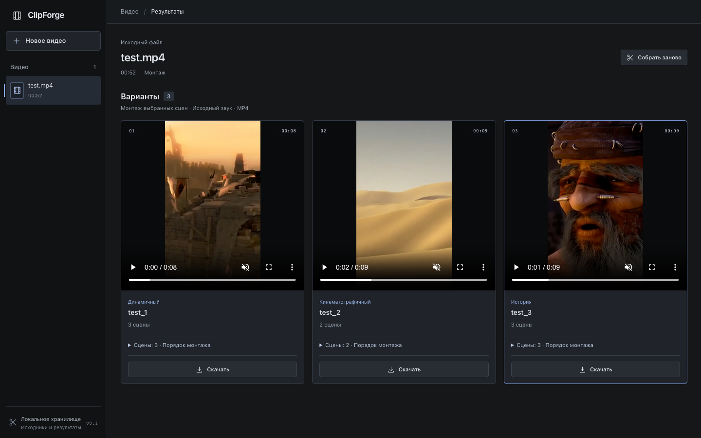
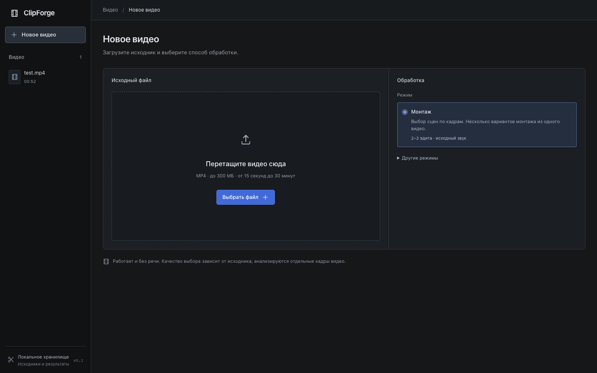

# ClipForge

ClipForge собирает короткие ролики из загруженного MP4. OpenAI выбирает сцены по кадрам, FFmpeg склеивает их в 2–3 варианта. Результат можно посмотреть и скачать в браузере.

Исходник — от 15 секунд, результат — 5–60 секунд. Сохраняется звук выбранных сцен; музыка, переходы и монтаж под бит пока не поддерживаются.



Пример на трейлере Sintel с подготовленным вручную монтажным планом. [Материалы скриншотов](docs/screenshots/README.md).



## Запуск

Нужен Docker с Compose.

```sh
cp .env.example .env
```

Для анализа кадров и речи нужен `OPENAI_API_KEY` в `.env`. Без ключа доступны нарезка по времени и демо экспорта.

```sh
docker compose up --build -d
```

Открыть [localhost:8080](http://localhost:8080). Если ключ добавлен уже после запуска:

```sh
docker compose up -d --force-recreate app analysis
```

## Устройство

Backend — Go, интерфейс — React. PostgreSQL хранит задания и результаты этапов, файлы лежат в общем volume. Kafka разделяет анализ и рендер между воркерами; ещё две группы записывают историю обработки и ошибки.

Задание и сообщение сохраняются одной транзакцией через outbox. При повторной доставке воркер проверяет поколение команды и аренду задания.

[Схема Kafka, повторы и replay истории](docs/kafka.md) · [Архитектура и ограничения](docs/architecture.md)

## Проверка

```sh
make test
```

Проверки работающего Compose без ключа OpenAI:

```sh
make smoke
make kafka-smoke
```

Второй сценарий останавливает Kafka, проверяет восстановление доставки, DLQ и повторное чтение истории. Для тестов хранилища и брокера нужны отдельные PostgreSQL и Kafka — настройка описана в [руководстве по разработке](docs/development.md#тесты).

[HTTP API](docs/api.md) · [Локальный запуск и настройки](docs/development.md)
