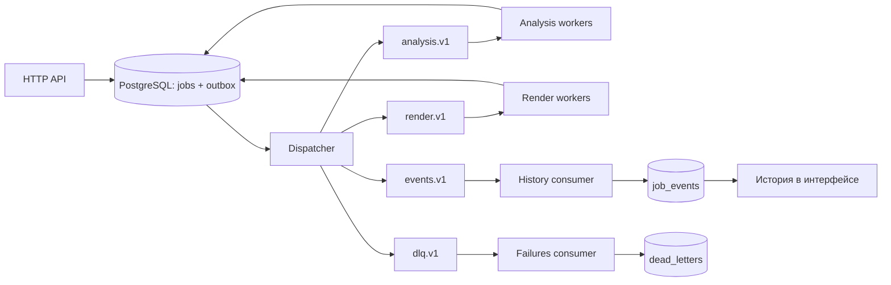

# Kafka в ClipForge

Kafka разделяет обработку видео по нагрузке и хранит события для независимых consumers. Анализ обращается к AI-провайдеру, рендер занимает CPU и запускает FFmpeg. История задания строится отдельным consumer и может быть перечитана без повторного монтажа.

Для небольшой нагрузки PostgreSQL-очереди было бы достаточно. Kafka добавляет брокер, offsets, retention и необходимость обработки дублей. Здесь это оправдано как архитектурный сценарий с независимыми потоками работы и воспроизводимым журналом; само наличие нескольких топиков не делает систему быстрее.

## Топики и группы

| Топик | Содержимое | Группа | Хранение в Kafka |
| --- | --- | --- | --- |
| `clipforge.analysis.v1` | Команда на `probe`, `transcribe` или `select` | `clipforge-analysis` | 1 день |
| `clipforge.render.v1` | Команда на рендер сохранённого плана | `clipforge-render` | 1 день |
| `clipforge.events.v1` | Изменения статуса, этапа и попыток | `clipforge-history` | 7 дней |
| `clipforge.dlq.v1` | Терминальные ошибки заданий и невалидные сообщения | `clipforge-failures` | 30 дней |

Все четыре топика создаются приложением явно: по умолчанию 3 partitions, replication factor 1, `cleanup.policy=delete`. Автосоздание топиков на брокере отключено. Retention определяет срок доступности записи для replay, а не срок хранения файлов или строк в PostgreSQL.

Ключ сообщения — `job_id`: сообщения задания внутри одного топика попадают в одну partition. Для невалидной внешней записи в DLQ сохраняется исходный ключ. Между топиками общего порядка нет. В истории он восстанавливается по `sequence`, которая возрастает внутри задания.

Команда содержит только `id`, `job_id`, `generation` и `stage`. Видео, расшифровки и планы не передаются через Kafka: воркер читает БД и общее файловое хранилище. Модель сообщения версионируется именем топика `.v1`.



## Путь одного видео

1. API сохраняет исходник и создаёт строку `jobs`. SQL-триггеры в той же транзакции записывают `job.queued` и команду анализа в outbox.
2. Dispatcher берёт до 20 доступных строк под advisory lock. Публикует каждую с подтверждением Kafka, удаляет строки и коммитит транзакцию PostgreSQL. Другой dispatcher в это время не публикует следующую пачку.
3. Analysis consumer получает команду. SQL проверяет поколение, этап, статус и время доступности, затем выдаёт аренду с новым токеном. Повторная команда уже занятого или завершённого поколения ничего не запускает.
4. Анализ сохраняет результаты этапов. После выбора сцен он атомарно сохраняет план, ставит `render` в очередь и выпускает новую команду через outbox. Его consumer освобождается для другого видео.
5. Render consumer читает план, собирает MP4 и фиксирует результат с проверкой токена аренды. Kafka offset подтверждается после успешного обработчика. Ошибка записи в БД оставляет сообщение неподтверждённым.
6. History consumer читает события и обновляет `job_events`. API и интерфейс читают эту проекцию. Отдельная группа failures сохраняет DLQ для диагностики.

## Сбои и повторы

| Ситуация | Поведение |
| --- | --- |
| Kafka недоступна после запуска API | Задание и outbox остаются в PostgreSQL; доставка ждёт восстановления брокера |
| Брокер принял сообщение, но коммит outbox не завершился | Пачка может быть опубликована повторно |
| Consumer упал после сохранения результата, но до commit offset | Запись приходит повторно; поколение команды и состояние задания предотвращают повторный запуск завершённой работы |
| Воркер остановился во время этапа | Dispatcher находит просроченную аренду и создаёт новую команду либо фиксирует исчерпание попыток |
| Consumer простаивал дольше retention команд | Dispatcher повторно выпускает давно опубликованную команду для всё ещё ожидающего задания; идентификатор и поколение сохраняются |
| AI вернул временную ошибку | Новая команда ждёт `available_at` в outbox; Kafka partition не удерживается на время задержки |
| Ошибка окончательная или попытки исчерпаны | `job.failed` уходит в events, описание сбоя — в DLQ |
| JSON или поля входящего сообщения невалидны | Consumer подтверждает исходную запись только после публикации диагностики в DLQ |

Для восстановления ожидающей команды используются `jobs.dispatched_at`, отсутствие неопубликованной команды в outbox и интервал 15 минут. Это повторная доставка через Kafka, а не резервное выполнение из SQL.

У relay остаётся окно между подтверждением Kafka и коммитом PostgreSQL. Поэтому доставка — at least once. Идемпотентный producer не устраняет это окно после перезапуска процесса. `generation` защищает от старых команд, а токен аренды — от старого воркера, который пытается записать результат после потери владения.

Запрос к OpenAI или работа FFmpeg могут повториться, если процесс упал до сохранения checkpoint. Exactly-once для внешних действий нет. Kafka transactions не связывают коммит PostgreSQL, запрос к OpenAI и запись MP4 в одну транзакцию.

History consumer использует уникальные `id` и `(job_id, sequence)`. Повторное чтение не дублирует строки. История может отставать от состояния `jobs`; завершение видео от неё не зависит. В самом DLQ невалидная запись останавливает consumer с ошибкой, а не создаёт бесконечную цепочку новых DLQ-сообщений.

## Проверка в Compose

Все команды выполняются из корня репозитория с запущенным Compose. Имена групп ниже соответствуют стандартному `KAFKA_GROUP_PREFIX=clipforge`.

Список топиков и параметры топика анализа:

```sh
docker compose exec kafka /opt/kafka/bin/kafka-topics.sh \
  --bootstrap-server kafka:9092 --list

docker compose exec kafka /opt/kafka/bin/kafka-topics.sh \
  --bootstrap-server kafka:9092 --describe --topic clipforge.analysis.v1
```

Распределение partitions и lag рендера:

```sh
docker compose exec kafka /opt/kafka/bin/kafka-consumer-groups.sh \
  --bootstrap-server kafka:9092 --describe --group clipforge-render
```

Второй процесс рендера:

```sh
docker compose up -d --scale render=2 render
```

При стандартном `RENDER_WORKERS=1` это два consumers одной группы. Они обрабатывают разные partitions. Три partitions позволяют активно работать не более чем трём consumers этой группы; лишние будут ждать. Масштабирование ускоряет обработку нескольких заданий, но не делит один монтаж между воркерами.

Чтение DLQ напрямую и через проекцию API:

```sh
docker compose exec kafka /opt/kafka/bin/kafka-console-consumer.sh \
  --bootstrap-server kafka:9092 --topic clipforge.dlq.v1 \
  --from-beginning --property print.key=true --timeout-ms 10000

curl -fsS http://localhost:8080/api/dead-letters
```

Console consumer завершится по таймауту, если новых сообщений нет. Для `invalid_message` диагностика содержит исходный topic, partition, offset и первые 16 КиБ значения в Base64. Для `job_failed` координаты равны `-1`: запись создана из состояния задания в БД.

После исправления причины ошибки повторяется задание, а не сырое сообщение из DLQ:

```sh
curl -X POST http://localhost:8080/api/jobs/JOB_ID/retry
```

Это создаёт новое поколение команды с сохранённого этапа. Невалидное сообщение без задания сначала разбирается по координатам; слепое копирование обратно воспроизведёт ту же ошибку.

Автоматический сценарий, включая остановку и восстановление брокера:

```sh
make kafka-smoke
```

## Replay истории

Остановить consumer событий, посмотреть план сброса offsets, выполнить сброс только группы истории и запустить её снова:

```sh
docker compose stop events

docker compose exec kafka /opt/kafka/bin/kafka-consumer-groups.sh \
  --bootstrap-server kafka:9092 --group clipforge-history \
  --topic clipforge.events.v1 --reset-offsets --to-earliest --dry-run

docker compose exec kafka /opt/kafka/bin/kafka-consumer-groups.sh \
  --bootstrap-server kafka:9092 --group clipforge-history \
  --topic clipforge.events.v1 --reset-offsets --to-earliest --execute

docker compose start events
```

Группа должна быть неактивной во время сброса. Если проекция сохранена, replay пройдёт без дубликатов. Если проекция восстановлена пустой, можно заново получить только события, ещё доступные в Kafka — по умолчанию за 7 дней. Это не полная резервная копия истории.

Команды не сбрасывают группы `clipforge-analysis` и `clipforge-render`; видео не исполняется заново. Новый независимый consumer событий, например для аналитики длительности этапов, может читать тот же топик со своей группой, не забирая записи у истории. Такой consumer в проекте пока не реализован.

## Выбор Kafka

- Разделение analysis и render позволяет независимо менять их параллелизм: ожидание AI и нагрузка FFmpeg имеют разные ограничения.
- Events — отдельный журнал фактов. История может догнать обработку после остановки или быть восстановлена повторным чтением. Для этого ей не нужно обращаться к очереди команд.
- DLQ сохраняет контекст необрабатываемого сообщения и отделяет его от следующих заданий. Это место диагностики, а не способ спрятать ошибку.
- PostgreSQL остаётся источником текущего состояния и владельца аренды. Outbox устраняет потерю сообщения между сохранением задания и попыткой отправки; дубли обрабатываются явно.

Для двух очередей заданий можно было выбрать PostgreSQL или RabbitMQ. Отличие этого сценария — сохранённый журнал с независимыми consumer groups и replay. Цена решения: дополнительная инфраструктура и согласованность между Kafka, БД и файловым хранилищем.

Compose использует один broker/controller без отказоустойчивости, TLS и SASL. Все воркеры видят локальный volume одного Docker-хоста. Масштабирование на разные машины потребует общего хранилища; отказоустойчивая Kafka — нескольких брокеров и другой политики репликации. Последовательный relay под advisory lock также ограничивает пропускную способность. Изменение настроек создания не меняет уже существующие топики.

Семантика commit offsets описана в [KafkaConsumer](https://kafka.apache.org/41/javadoc/org/apache/kafka/clients/consumer/KafkaConsumer.html); команды групп и изменения partitions — в [Basic Kafka Operations](https://kafka.apache.org/41/operations/basic-kafka-operations/). Compose использует [официальный образ Apache Kafka](https://kafka.apache.org/41/getting-started/docker/).
